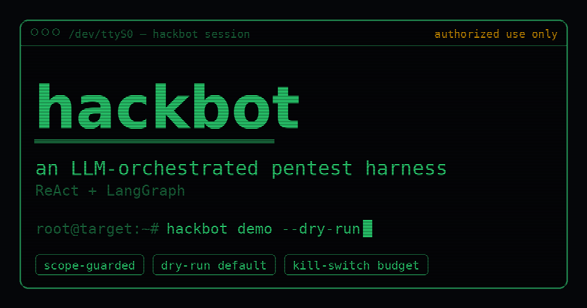

# hackbot

<p align="center">
  
</p>

<p align="center">
  <a href="https://saulofilho.github.io/hackbot/">website</a> ·
  <a href="#tutorial-your-first-run">tutorial</a> ·
  <a href="#safety-model">safety model</a> ·
  <a href="#cli-reference">cli</a>
</p>

**An LLM-orchestrated pentest harness (ReAct + LangGraph).**

`hackbot` runs an autonomous agent loop where a language model dynamically decides
which security tools to call against an **authorized** target. A hard **scope guard**
and a **budget/kill-switch** sit between the agent and the network so the model can
never touch a host it wasn't authorized to, exceed a request ceiling, or fire
destructive payloads.

> ⚠️ **Authorized use only.** Only point `hackbot` at systems you own or have
> explicit written permission to test. The `scope.json` file is the contract:
> if a target isn't in it, every network tool hard-fails with a `ScopeViolation`.

---

## Table of contents

1. [How it works](#how-it-works)
2. [Safety model](#safety-model)
3. [Install](#install)
4. [The scope file](#the-scope-file)
5. [Configuration (environment variables)](#configuration-environment-variables)
6. [Tutorial: your first run](#tutorial-your-first-run)
7. [CLI reference](#cli-reference)
8. [Tools exposed to the agent](#tools-exposed-to-the-agent)
9. [Example scenarios](#example-scenarios)
10. [Switching LLM providers](#switching-llm-providers)
11. [Project layout](#project-layout)
12. [Development & testing](#development--testing)
13. [Troubleshooting](#troubleshooting)

---

## How it works

`hackbot` is a classic **ReAct** agent built on **LangGraph**:

```
                 ┌─────────────────────────────────────────┐
                 │                                           │
                 ▼                                           │
   entry ──▶  [ agent ] ──route──▶ [ tools ] ───────────────┘
   (LLM decides what     │
    tool to call next)   │
                         ├──route──▶ [ tools_finish ] ──▶ [ report ] ──▶ END
                         │
                         └──route──▶ [ report ] ──▶ END
```

- The LLM receives the full tool list via `bind_tools` and **chooses dynamically**
  what to call at each step.
- Each tool result is fed back into the conversation; the agent iterates.
- The loop ends when **any** of these happens:
  1. the LLM calls the `finish` tool,
  2. the **budget** is exhausted (`max_steps` / `max_total_requests` / token cap),
  3. the LLM replies with **no tool calls** (nothing left to do).
- On exit, the `report` node renders a Markdown report from the accumulated
  `findings` and `actions_taken` state.

The agent's working memory (`AttackState`) accumulates `findings` and
`actions_taken` across the whole session so the report reflects everything that
happened.

---

## Safety model

These are the guardrails, and none of them can be bypassed by the LLM:

| Guard | Where | What it does |
|-------|-------|--------------|
| **Scope guard** | `scope_guard.check_target` | Every network tool calls it **before** any I/O. Parses the URL with the same parser that sends it, rejects userinfo (`user@host`), backslashes, whitespace/control chars and non-HTTP schemes, validates host (glob + CIDR), then **normalizes the path** (percent-decoding, `;params`, `.`/`..`, repeated slashes; double encoding is rejected) before matching allowed/excluded paths. Exclusions are case-insensitive and cover sub-paths. A violation raises `ScopeViolation`. |
| **IP policy / DNS pinning** | `scope_guard.resolve_target` | Resolves the host and validates **every** resolved IP. Cloud metadata (`169.254.169.254`, `fd00:ec2::254`, ...) is always denied; internal ranges (loopback, RFC 1918, link-local...) only pass if listed in `allowed_cidrs`, given as a literal IP in `allowed_hosts`, or reached via `localhost`. Requests then connect to the validated IP with the original `Host` header and TLS SNI, so DNS rebinding cannot change the destination. |
| **Egress hygiene** | `tools._prepare_headers`, `tools._new_client` | A `Host` header that differs from the target is rejected. HTTP clients use `trust_env=False` (env proxies ignored). `scan_js_bundle` follows redirects manually, re-checking every hop. |
| **Kill switch** | `scope_guard.check_target` | Hard-fails once `request_count >= max_total_requests`, independent of the soft budget counter. |
| **Dry-run** | `Settings.dry_run` (default `True`) | Network tools return a `DRY_RUN: would ...` string instead of sending anything. You must explicitly opt in with `--no-dry-run`. |
| **Authorization** | `Settings.require_authorization` (default `True`) | `run` refuses to start unless `scope.authorized_by` is set. |
| **Budget** | `budget.Budget` | Caps steps, total requests, and tokens. Raises `BudgetExhausted`, which routes the graph straight to the report. |
| **No destructive payloads** | `prompts.SYSTEM_PROMPT` | The agent is instructed never to send `DROP`, `rm -rf`, shutdown, fork bombs, etc., and to prefer reads over writes. |
| **No wildcard host** | `TargetScope` validator | `allowed_hosts` cannot contain a bare `"*"`. |
| **External tools gate** | `Settings.enable_external_tools` (default `False`) | `nuclei_scan`/`ffuf_scan`/`sqlmap_scan` refuse to run at all — even in dry-run — until explicitly enabled. A second, independent gate on top of scope/dry-run. |
| **sqlmap allowlist** | `tools.sanitize_sqlmap_args` | `extra_args` must only use allowlisted flags (`-p`, `--technique`, `--dbms`, `--cookie`, `--threads` (max 4), ...). Anything else, including `-u`, `-m`, `-g`, `-l`, `--alert`, `--proxy`, `--tamper`, abbreviated flags or a `Host` header, is rejected. `--batch --risk=1 --level=1` are always forced. |
| **Verified findings** | `verify_finding` tool | Re-executes the HTTP PoC and checks it against an expected status/substring **before** registering anything. A scope violation, dry-run, or mismatch means nothing is saved. |

---

## Install

Requires **Python ≥ 3.11**.

### With `pip`

```bash
pip install -e ".[dev]"
```

### With `uv` (if you don't have `pip` on your PATH)

```bash
uv venv --python 3.12 .venv
source .venv/bin/activate
uv pip install -e ".[dev]"
```

Then copy the environment template and edit your scope:

```bash
cp .env.example .env     # set your API key (or leave dry-run/demo, which need none)
$EDITOR scope.json       # define the authorized target
```

---

## The scope file

`scope.json` is the authorization contract. Example:

```json
{
  "allowed_hosts": ["localhost", "127.0.0.1", "juice-shop.lab"],
  "allowed_cidrs": ["10.10.10.0/24"],
  "allowed_paths": ["/*"],
  "exclude_paths": ["/logout", "/admin/delete"],
  "max_requests_per_second": 5.0,
  "authorized_by": "you@yourcompany.com",
  "authorization_ref": "TICKET-SEC-123"
}
```

| Field | Meaning |
|-------|---------|
| `allowed_hosts` | Glob patterns (`fnmatch`). `*.lab` matches `juice-shop.lab`. A bare `"*"` is rejected. |
| `allowed_cidrs` | IP ranges. A target whose host is an IP inside one of these is allowed. Also required when an allowed **hostname** resolves to an internal IP (e.g. `juice-shop.lab` -> `10.10.10.5`). Cloud metadata addresses are denied even if listed. |
| `allowed_paths` | Glob patterns a request path must match (e.g. `"/*"`, `"/api/*"`). |
| `exclude_paths` | Glob patterns that are **always** blocked, even if `allowed_paths` would allow them. |
| `max_requests_per_second` | Client-side rate limit applied between live requests. |
| `authorized_by` | Required when `require_authorization=True` (the default). Who signed off. |
| `authorization_ref` | Free-form reference (ticket, engagement ID) recorded for the audit trail. |

---

## Configuration (environment variables)

All settings use the `PH_` prefix and can live in `.env`. Defaults shown:

| Variable | Default | Description |
|----------|---------|-------------|
| `PH_LLM_PROVIDER` | `openai` | `openai` or `anthropic`. |
| `PH_LLM_MODEL` | `gpt-4o-mini` | Model id for the chosen provider. |
| `PH_LLM_BASE_URL` | *(unset)* | Override the OpenAI-compatible base URL (DeepSeek, GLM/Zhipu, local, …). |
| `PH_OPENAI_API_KEY` | *(unset)* | Required for `openai` provider. |
| `PH_ANTHROPIC_API_KEY` | *(unset)* | Required for `anthropic` provider. |
| `PH_LLM_TEMPERATURE` | `0.2` | Sampling temperature. |
| `PH_DRY_RUN` | `true` | Network tools simulate instead of sending. |
| `PH_REQUIRE_AUTHORIZATION` | `true` | `run` needs `scope.authorized_by`. |
| `PH_MAX_TOTAL_REQUESTS` | `200` | Kill-switch request ceiling. |
| `PH_MAX_STEPS` | `20` | Max agent iterations. |
| `PH_MAX_TOKENS_BUDGET` | `200000` | Token budget across the session. |
| `PH_USER_AGENT` | `hackbot/0.1 (+authorized-pentest)` | Sent on every live request. |
| `PH_ENABLE_EXTERNAL_TOOLS` | `false` | Second gate, independent of `dry_run`, required before `nuclei_scan`/`ffuf_scan`/`sqlmap_scan` will run at all. |
| `PH_EXTERNAL_TOOL_TIMEOUT` | `60` | Seconds before an external scanner subprocess is killed. |
| `PH_NUCLEI_BIN` / `PH_FFUF_BIN` / `PH_SQLMAP_BIN` | `nuclei` / `ffuf` / `sqlmap` | Binary name or path looked up on `PATH`. |

> The `demo` and `--dry-run` paths **do not need an API key** — `demo` uses a fake
> scripted LLM and dry-run never hits the network.

---

## Tutorial: your first run

This walks from zero to a real (authorized) scan.

### 1. Smoke-test the loop with no API key and no network

```bash
hackbot demo --dry-run
```

This runs the full ReAct loop against a **fake** LLM that scripts the sequence
`check_scope → http_probe → save_finding → finish`, then prints the Markdown
report. Expected tail:

```
# Relatorio de Pentest (hackbot)
**Alvo:** http://localhost:3000/
**Budget:** {'steps': 4, 'requests': 0, 'tokens': 0, 'exhausted_reason': None}
**Achados:** 1
## Achados
- **[LOW]** demo finding — http://localhost:3000/
```

If you see that, the install and the graph are healthy.

### 2. Confirm your scope is correct

Before any live run, sanity-check which URLs pass the guard:

```bash
hackbot check-scope http://localhost:3000 scope.json   # -> OK,        exit 0
hackbot check-scope http://evil.com      scope.json     # -> VIOLACAO,  exit 1
```

Use this in CI or a pre-flight script: a non-zero exit means "out of scope,
do not proceed."

### 3. Configure the LLM

```bash
cp .env.example .env
# edit .env:
#   PH_LLM_PROVIDER=openai
#   PH_LLM_MODEL=gpt-4o-mini
#   PH_OPENAI_API_KEY=sk-...
```

### 4. Dry-run against a real target (still sends nothing)

```bash
hackbot run --target http://localhost:3000 --scope-file scope.json --dry-run
```

The real LLM now drives the loop and decides which tools to call, but every
network tool returns `DRY_RUN: would ...`. This is the safe way to watch the
agent's plan before letting it touch anything.

### 5. Go live (only on an authorized target)

```bash
hackbot run \
  --target http://juice-shop.lab \
  --scope-file scope.json \
  --no-dry-run \
  --output report.md
```

Now network tools actually fire — still gated by the scope guard, rate limit,
and budget. The report is printed and written to `report.md`.

---

## CLI reference

### `hackbot demo`

```
hackbot demo [--dry-run / --no-dry-run]
```

Runs the ReAct loop with a fake scripted LLM. Reads `scope.json` from the current
directory. No API key required. Great for smoke tests and CI.

### `hackbot check-scope`

```
hackbot check-scope <TARGET_URL> <SCOPE_FILE>
```

Validates a single URL against a scope file. Prints `OK` (exit 0) or
`VIOLACAO <reason>` (exit 1). Positional arguments.

### `hackbot run`

```
hackbot run --target <URL> --scope-file <PATH> [--dry-run / --no-dry-run] [--output <PATH>]
```

| Option | Default | Description |
|--------|---------|-------------|
| `--target` | *(required)* | Target URL. |
| `--scope-file` | *(required)* | Path to the scope JSON. |
| `--dry-run / --no-dry-run` | `--dry-run` | Simulate vs. actually send requests. |
| `--output` | *(none)* | Also write the Markdown report to this file. |

`run` refuses to start if `require_authorization` is on and `scope.authorized_by`
is empty.

---

## Tools exposed to the agent

| Tool | Scope-guarded | Dry-run | External gate | Purpose |
|------|:---:|:---:|:---:|---------|
| `check_scope(url)` | — | — | — | Validate a URL against the scope. The agent is told to call this first. |
| `http_probe(url, method, headers, body)` | ✅ | ✅ | — | HTTP request. Methods limited to `GET/HEAD/OPTIONS/POST/PUT/PATCH`. Rate-limited. |
| `scan_js_bundle(url)` | ✅ | ✅ | — | Download a JS file and scan it: regex secret patterns **and** a real AST walk (see below) — not just substring grepping. |
| `analyze_text_for_secrets(text)` | — | — | — | Regex + AST scan of pasted text. Local only, no I/O. |
| `save_finding(title, severity, evidence, url)` | — | — | — | Record an observational finding (no PoC re-check). Severity ∈ `CRITICAL/HIGH/MEDIUM/LOW/INFO`. Stored with `verified: false`. |
| `verify_finding(title, severity, url, method, expected_status, expected_substring, ...)` | ✅ | ✅ | — | **Re-executes** the HTTP PoC and only registers the finding (`verified: true`) if the response actually matches. Nothing is saved on a scope violation, dry-run, budget cap, or mismatch. |
| `nuclei_scan(url, templates)` | ✅ | ✅ | ✅ | Run `nuclei` against the target. Requires the binary on `PATH` and `PH_ENABLE_EXTERNAL_TOOLS=true`. |
| `ffuf_scan(url, wordlist, extra_args)` | ✅ | ✅ | ✅ | Run `ffuf` for path/param fuzzing. Auto-appends the `FUZZ` marker if the URL doesn't already have one. |
| `sqlmap_scan(url, data, extra_args)` | ✅ | ✅ | ✅ | Run `sqlmap` in non-interactive, low-risk mode. `--batch --risk=1 --level=1` are always forced; destructive flags (`--os-shell`, `--file-write`, `--dump-all`, …) are always rejected, even if requested in `extra_args`. |
| `finish(reason)` | — | — | — | End the loop and trigger the report. |

The secret detectors (`SECRET_PATTERNS` in `tools.py`) cover: AWS access key ids
(`AKIA…`), OpenAI-style keys (`sk-…`), JWTs, 13–19 digit card numbers, and PEM
private key headers — checked both by regex and against string literals found
in the AST.

### AST-based JS analysis

`scan_js_bundle` and `analyze_text_for_secrets` parse the JS with
[`esprima`](https://pypi.org/project/esprima/) and walk the real syntax tree
instead of grepping for substrings like `"eval("`. It flags:

- **Dangerous execution** — `eval(...)`, `new Function(...)`.
- **Obfuscation/decoding** — `atob`, `btoa`, `escape`, `unescape`.
- **Exfiltration sinks** — `document.cookie`, `window.localStorage`,
  `window.sessionStorage`, `navigator.sendBeacon`.
- **Outbound network calls** — `fetch(...)`, `new XMLHttpRequest(...)`.
- **Secrets embedded as string literals** — any literal ≥16 chars matched
  against `SECRET_PATTERNS`.

If `esprima` can't parse the file (not valid JS, or it fails to import), the
tool degrades gracefully: it says so and the regex pass still runs — it never
raises or blocks the loop.

### External tools: nuclei / ffuf / sqlmap

These wrap real, well-known scanners and are **off by default**, behind
`PH_ENABLE_EXTERNAL_TOOLS` — a second gate on top of scope and dry-run, so the
agent can never reach for them unless the operator explicitly opted in and
installed the binaries. All three:

- call `check_target` before building a command,
- run via `asyncio.create_subprocess_exec` with a **list** argv — never
  `shell=True` — so nothing an argument contains can break out into a shell,
- respect `dry_run` (return the exact command that *would* run, nothing is
  executed), the budget, and `PH_EXTERNAL_TOOL_TIMEOUT`,
- fail with a clear message (not a crash) if the binary isn't on `PATH`.

`sqlmap_scan` checks `extra_args` against an allowlist
(`tools.sanitize_sqlmap_args`): any flag not listed, such as `-u` (target swap),
`-m`/`-l`/`-g`, `--alert`, `--proxy`, `--tamper`, `--os-shell` or an
abbreviation like `--os-sh`, is rejected. It always forces
`--batch --risk=1 --level=1`, dropping any `--risk`/`--level` from `extra_args`.

### `verify_finding` vs `save_finding`

`save_finding` trusts the agent's narrative — useful for purely observational
notes. `verify_finding` is the stricter, PoC-backed path: it replays the HTTP
request through the exact same guarded/budgeted code path as `http_probe`,
and only appends to the findings list (with `verified: true`) if the response
actually matches an `expected_status` and/or `expected_substring` you give
it. A scope violation, dry-run, exhausted budget, or a response that doesn't
match means **nothing is recorded** — the agent gets a `NAO_VERIFICADO` /
`NAO_REPRODUZIDO` message back instead, so it can't silently report something
it never actually reproduced. The system prompt tells the agent to prefer
`verify_finding` for anything with a reproducible PoC (IDOR, auth bypass,
missing headers, exposed secrets) and reserve `save_finding` for notes that
have no direct HTTP check.

---

## Example scenarios

### A. CI gate — "is this target in scope?"

Fail a pipeline before any tooling touches an unauthorized host:

```bash
if hackbot check-scope "$TARGET" scope.json; then
  echo "in scope, proceeding"
else
  echo "OUT OF SCOPE — aborting"; exit 1
fi
```

### B. Watch the agent plan a recon pass without sending anything

```bash
hackbot run --target http://localhost:3000 --scope-file scope.json --dry-run
```

The report's "Acoes executadas" section lists every `DRY http_probe …` the model
intended, so you can review its plan before going live.

### C. Authorized recon against a lab (OWASP Juice Shop)

```jsonc
// scope.json
{
  "allowed_hosts": ["juice-shop.lab"],
  "allowed_cidrs": [],
  "allowed_paths": ["/*"],
  "exclude_paths": ["/logout", "/api/*/delete"],
  "max_requests_per_second": 3.0,
  "authorized_by": "you@yourcompany.com",
  "authorization_ref": "LAB-2024"
}
```

```bash
hackbot run --target http://juice-shop.lab --scope-file scope.json --no-dry-run --output juice.md
```

### D. Lock scope to an internal CIDR by IP

```jsonc
{
  "allowed_hosts": [],
  "allowed_cidrs": ["10.10.10.0/24"],
  "allowed_paths": ["/*"],
  "exclude_paths": [],
  "max_requests_per_second": 5.0,
  "authorized_by": "you@yourcompany.com",
  "authorization_ref": "ENG-77"
}
```

```bash
hackbot check-scope http://10.10.10.42/health scope.json   # OK
hackbot check-scope http://10.20.0.1/health   scope.json   # VIOLACAO
```

### E. Protect a dangerous endpoint even though the path glob allows it

With `"allowed_paths": ["/*"]` and `"exclude_paths": ["/admin/delete"]`:

```bash
hackbot check-scope http://localhost:3000/admin/users  scope.json   # OK
hackbot check-scope http://localhost:3000/admin/delete scope.json   # VIOLACAO (excluded)
```

---

## Switching LLM providers

`hackbot` speaks the OpenAI and Anthropic APIs. Any OpenAI-compatible endpoint
(DeepSeek, GLM/Zhipu, local servers) works by setting `PH_LLM_BASE_URL`.

**OpenAI**

```bash
export PH_LLM_PROVIDER=openai
export PH_LLM_MODEL=gpt-4o-mini
export PH_OPENAI_API_KEY=sk-...
```

**DeepSeek (OpenAI-compatible)**

```bash
export PH_LLM_PROVIDER=openai
export PH_LLM_MODEL=deepseek-chat
export PH_LLM_BASE_URL=https://api.deepseek.com/v1
export PH_OPENAI_API_KEY=sk-...
```

**GLM / Zhipu (OpenAI-compatible)**

```bash
export PH_LLM_PROVIDER=openai
export PH_LLM_MODEL=glm-4.6
export PH_LLM_BASE_URL=https://open.bigmodel.cn/api/paas/v4
export PH_OPENAI_API_KEY=...
```

**Anthropic**

```bash
export PH_LLM_PROVIDER=anthropic
export PH_LLM_MODEL=claude-3-5-sonnet-latest
export PH_ANTHROPIC_API_KEY=sk-ant-...
```

### fish shell

If your shell is `fish`, use `set -x` instead of `export`. Each block below is
self-contained (sets every variable it needs).

```fish
# DeepSeek
set -x PH_LLM_PROVIDER openai
set -x PH_LLM_MODEL deepseek-chat
set -x PH_LLM_BASE_URL https://api.deepseek.com/v1
set -x PH_OPENAI_API_KEY sk-...

# GLM / Zhipu (OpenAI-compatible)
set -x PH_LLM_PROVIDER openai
set -x PH_LLM_MODEL glm-4.6
set -x PH_LLM_BASE_URL https://open.bigmodel.cn/api/paas/v4
set -x PH_OPENAI_API_KEY ...

# Anthropic
set -x PH_LLM_PROVIDER anthropic
set -x PH_LLM_MODEL claude-3-5-sonnet-latest
set -x PH_ANTHROPIC_API_KEY sk-ant-...
```

---

## Project layout

```
hackbot/
├── pyproject.toml
├── .env.example
├── scope.json
├── README.md
├── src/hackbot/
│   ├── __init__.py
│   ├── config.py        # Settings + TargetScope (pydantic)
│   ├── budget.py        # Budget + BudgetExhausted (step/request/token caps)
│   ├── scope_guard.py   # check_target + ScopeViolation (the hard gate)
│   ├── llm.py           # build_llm (openai/anthropic/base_url)
│   ├── prompts.py       # SYSTEM_PROMPT (rules of engagement)
│   ├── state.py         # AttackState (LangGraph TypedDict)
│   ├── tools.py         # agent tools: http/JS-AST/verify_finding/nuclei/ffuf/sqlmap
│   ├── graph.py         # the ReAct graph: agent → tools → report
│   └── cli.py           # typer CLI: run / demo / check-scope
├── scripts/
│   └── make_og.py       # regenerates docs/og.png (social share thumbnail)
├── docs/                # GitHub Pages site (phosphor-CRT theme)
│   ├── index.html
│   ├── favicon.svg
│   └── og.png
└── tests/
    ├── test_scope_guard.py
    ├── test_budget.py
    ├── test_agent_loop.py
    └── test_tools.py    # AST scan, nuclei/ffuf/sqlmap gating, verify_finding
```

---

## Development & testing

```bash
pytest -q            # run the suite (28 tests)
ruff check .         # lint
```

The test suite validates the scope guard (out-of-scope host, wildcard subdomain,
excluded path, kill switch, wildcard-host rejection), the budget caps, the full
ReAct loop end-to-end with a fake LLM, the AST/regex JS analysis, and that the
external-tool wrappers and `verify_finding` never run or save anything outside
their guardrails — no network, no subprocess, and no API key required.

---

## Troubleshooting

| Symptom | Cause / fix |
|---------|-------------|
| `pip: command not found` | Use the `uv` install path above, or `python -m pip install -e ".[dev]"`. |
| `PH_OPENAI_API_KEY ausente` | `run` with the `openai` provider needs a key. Use `demo`/`--dry-run` for keyless testing. |
| `scope.authorized_by e obrigatorio` | Set `authorized_by` in `scope.json`, or set `PH_REQUIRE_AUTHORIZATION=false` (not recommended). |
| Every tool returns `VIOLACAO` | The target isn't in `allowed_hosts`/`allowed_cidrs`, its path isn't in `allowed_paths`, or it matches an `exclude_paths` entry. Check with `check-scope`. |
| Loop ends immediately with an empty report | The LLM returned no tool calls on the first step. Check your model/key and the system prompt. |
| `nuclei_scan`/`ffuf_scan`/`sqlmap_scan` return `DESABILITADO` | Set `PH_ENABLE_EXTERNAL_TOOLS=true` **and** make sure the corresponding binary is installed and on `PATH`. |
| `sqlmap_scan` returns `BLOQUEADO: flag nao permitida ...` | That flag is not on the allowlist (`tools.sanitize_sqlmap_args`) and cannot be passed via `extra_args`, by design. |
| `verify_finding` keeps returning `NAO_VERIFICADO`/`NAO_REPRODUZIDO` | Either it's running in dry-run (nothing is sent), the URL is out of scope, or the live response genuinely doesn't match `expected_status`/`expected_substring`. Check with `http_probe` first. |
